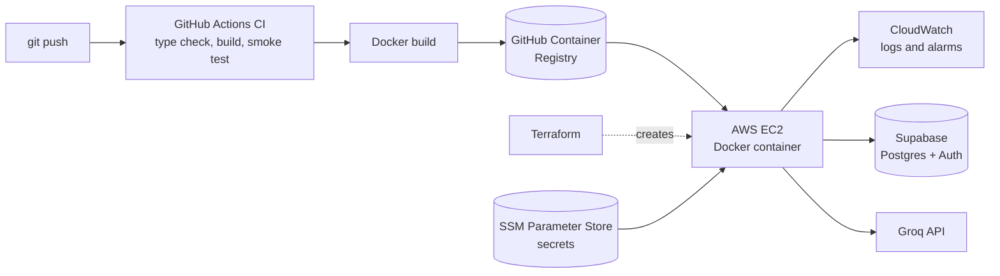

# FitCoach AI

[](https://github.com/DonthiNagaSai/FitCoach/actions/workflows/ci.yml)
[](https://github.com/DonthiNagaSai/FitCoach/actions/workflows/docker.yml)
[](https://github.com/DonthiNagaSai/FitCoach/actions/workflows/terraform.yml)

A full-stack fitness app. You tell it about yourself, and it builds a 7-day workout split and a meal plan with calorie and macro targets. A chat coach answers questions with your profile and current plan as context, and a progress page charts your weight over time.

Built with Next.js, TypeScript and Tailwind on the front end, Supabase for sign-in and the database, and OpenAI's open-weight GPT-OSS 120B model running on Groq's free tier for the AI parts. The whole thing runs at no cost.

**Live demo:** https://fitcoach-ai-navy-one.vercel.app (sign up with any email, it's free)

## Stack

- Next.js 15 (App Router), TypeScript and Tailwind CSS v4
- Supabase: Postgres, built-in auth and Row Level Security
- Groq's OpenAI-compatible API (GPT-OSS 120B), called only from server-side routes
- Recharts for the progress chart
- Docker (multi-stage build, non-root user, health check)
- GitHub Actions for CI and image builds, pushed to GitHub Container Registry
- Terraform for the AWS setup (EC2, IAM, CloudWatch, Budgets)

## Features

- Sign up, log in and an onboarding form for age, height, weight, goal, activity level, diet restrictions and equipment
- AI-generated 7-day workout split with sets, reps, weights and rest times
- AI-generated daily meal plan with calorie, protein, carb and fat targets
- Coach chat that knows your profile and latest plan
- Weight logging with a trend chart
- Daily caps per user (5 plans and 30 coach messages by default) so the free AI quota isn't used up by one person

## Running it locally

### 1. Install dependencies

```bash
npm install
```

### 2. Create a Supabase project

1. Create a free project at [supabase.com](https://supabase.com).
2. In the SQL Editor, run `supabase/schema.sql`. It creates the `profiles`, `plans`, `weight_logs` and `chat_messages` tables with Row Level Security, so each user can only read and write their own rows.
3. In **Project Settings > API**, copy the Project URL and the `anon` public key.

### 3. Get a Groq API key

Sign up at [console.groq.com](https://console.groq.com) and create an API key. The free tier needs no credit card. If the free limit is reached, Groq returns a rate-limit error and the app shows a "try again later" message; you are never charged.

### 4. Set environment variables

```bash
cp .env.example .env.local
```

Then fill in `NEXT_PUBLIC_SUPABASE_URL`, `NEXT_PUBLIC_SUPABASE_ANON_KEY` and `GROQ_API_KEY`. You can also set `GROQ_MODEL`, `DAILY_PLAN_LIMIT` and `DAILY_CHAT_LIMIT` if you want to change the defaults.

### 5. Run it

```bash
npm run dev
```

Open http://localhost:3000, sign up, finish onboarding, and your first plan is generated.

## How it's wired together

- Auth: Supabase Auth through `@supabase/ssr`. `src/lib/supabase/client.ts` is used in client components and `src/lib/supabase/server.ts` in API routes. The `(app)` layout checks for a session and sends you to `/login` if there isn't one.
- AI helper: `src/lib/ai.ts` calls Groq's chat completions endpoint with `fetch`, so there's no extra SDK. It also pulls the JSON object out of the model's reply.
- Plan generation: `POST /api/plans/generate` sends the profile to the model and asks for JSON in a fixed shape (7-day workout plus diet). It checks both sections are there, then saves the plan to the `plans` table.
- Coach: `POST /api/coach` sends your message, the last 20 chat messages, your profile and your latest plan, and returns the reply. Chat history is saved to `chat_messages` from the browser.
- Daily caps: `src/lib/limits.ts` counts today's plans and coach messages for the signed-in user before calling the AI.
- Progress: the Progress page reads and writes `weight_logs` straight from the browser, which is safe because of Row Level Security.

## DevOps: Docker, CI/CD and AWS



### Pipelines

There are three workflows in `.github/workflows`:

- `ci.yml` runs on every push and pull request. It installs dependencies, runs the TypeScript check, does a production build, then starts the built server and calls `/api/health` to make sure it actually boots.
- `docker.yml` runs on pushes to `main`. It builds the Docker image with layer caching and pushes it to `ghcr.io/donthinagasai/fitcoach`, tagged `latest` and with the short commit SHA.
- `terraform.yml` runs `terraform fmt -check` and `terraform validate` whenever the infrastructure code changes.

### Running with Docker

```bash
cp .env.example .env    # fill in the values
docker compose up --build
```

The image uses Next.js standalone output, so the final stage only has the compiled server and static files, not the full `node_modules`. It runs as a non-root user and has a `HEALTHCHECK` that hits `/api/health`.

### Deploying to AWS with Terraform

`infra/terraform` creates:

- An EC2 instance (t3.micro, Amazon Linux 2023) that installs Docker on boot and runs the image from GHCR
- An Elastic IP and a security group that only opens port 80. There's no SSH; you get a shell through SSM Session Manager.
- An IAM role that can only read `/fitcoach/*` from Parameter Store and write to its own log group
- A CloudWatch log group for the container logs, an alarm that auto-recovers the instance if its status check fails, and a high CPU alarm
- An AWS Budget that emails you when spend is forecast to pass $5 a month

Secrets never go into Terraform or the repo. Put them in Parameter Store first:

```bash
aws ssm put-parameter --name /fitcoach/GROQ_API_KEY --type SecureString --value "<key>"
```

Next.js bakes `NEXT_PUBLIC_*` values into the build, so the Supabase URL and anon key are set as GitHub repository variables (Settings > Secrets and variables > Actions > Variables) instead. The Docker workflow passes them in as build arguments. Both are public values; Row Level Security is what protects the data.

Then:

```bash
cd infra/terraform
cp terraform.tfvars.example terraform.tfvars   # set your email
terraform init
terraform plan
terraform apply
```

The output prints the app URL and health check URL. Run `terraform destroy` when you're done so it stops using credits. The GHCR package has to be public (or the instance needs a pull token) for EC2 to pull the image.

## Deploying to Vercel (free)

1. Import the repo into [Vercel](https://vercel.com) on the free Hobby plan.
2. Add the three environment variables in the Vercel project settings.
3. Deploy. Supabase is already hosted, so nothing else is needed.

Supabase pauses free projects after about a week with no database activity. If you get the warning email, open the project dashboard to keep it running.

## Known limitations

- Completion checkboxes for exercises and meals are local UI state and aren't saved yet. A `plan_progress` table would be the next step.
- Password change and account deletion in Settings aren't wired up yet.
- No email reminders yet. They'd need a scheduled job (Vercel Cron or a Supabase Edge Function) and an email provider.
- The daily caps count per user, so many new sign-ups in one day could still use up Groq's free quota. When that happens the app shows a friendly error instead of charging anything.
